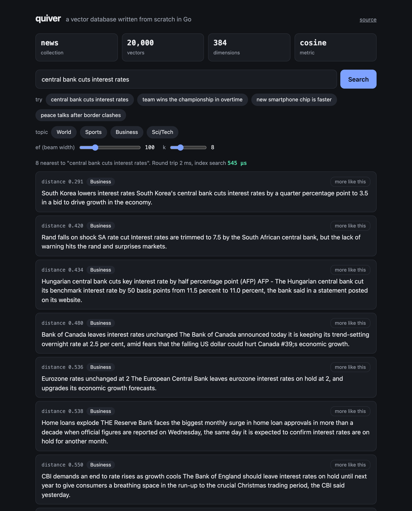
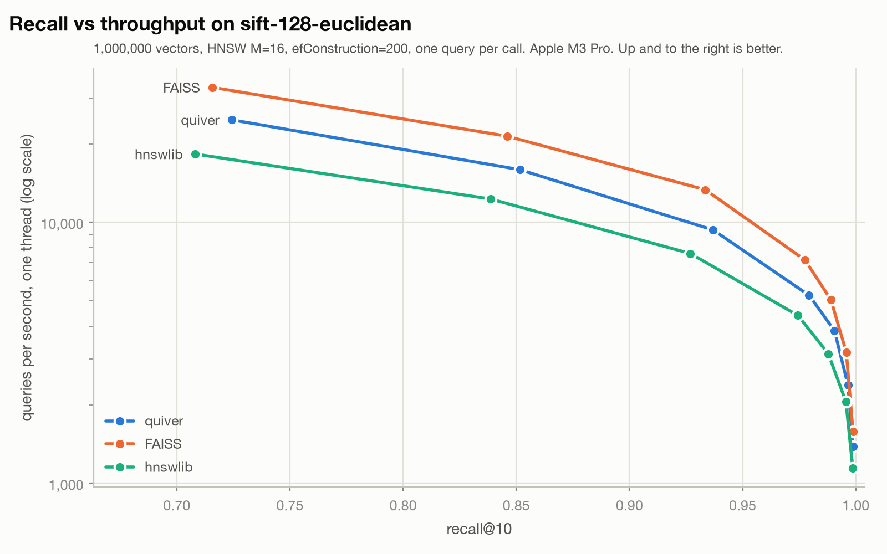

# quiver

A vector database written from scratch in Go, with no dependencies outside the standard library.

**Live demo: https://quiver-i5qu.onrender.com** (read-only, free tier, so the first load after a quiet spell takes up to a minute)

It has an HNSW index, a write-ahead log with group commit, snapshots, crash recovery, payload filters and an HTTP API. The distance kernels are hand-written ARM64 NEON assembly. On SIFT1M it lands between FAISS and hnswlib at the same recall.



The built-in UI running semantic search over 20,000 news articles. The query is embedded in the browser; the server only sees vectors.



## Benchmark

SIFT1M (`sift-128-euclidean` from ann-benchmarks): 1,000,000 vectors, 128 dimensions, 10,000 queries. Every engine uses M=16 and efConstruction=200. QPS is one thread, one query per call, best of three passes, on an Apple M3 Pro.

| ef | quiver recall@10 | quiver QPS | FAISS recall@10 | FAISS QPS | hnswlib recall@10 | hnswlib QPS |
|---:|---:|---:|---:|---:|---:|---:|
| 10 | 0.724 | 24,712 | 0.716 | 32,904 | 0.708 | 18,269 |
| 40 | 0.937 | 9,349 | 0.934 | 13,325 | 0.927 | 7,597 |
| 80 | 0.979 | 5,254 | 0.978 | 7,177 | 0.974 | 4,400 |
| 120 | 0.991 | 3,849 | 0.989 | 5,053 | 0.988 | 3,137 |
| 200 | 0.997 | 2,385 | 0.996 | 3,179 | 0.996 | 2,056 |

| | quiver | FAISS 1.15.1 | hnswlib 0.8.0 |
|---|---:|---:|---:|
| Build, 11 threads | 56.9 s | 51.3 s | 82.2 s |
| All-cores QPS at ef=40 | 57,848 | 72,057 | 44,419 |
| Index on disk | 660 MB | 656 MB | 660 MB |

Read these with the caveats in mind:

- The machine was not idle. Repeated runs moved single-thread QPS by up to 15%, so smaller gaps are noise.
- hnswlib's hand-written kernels are SSE/AVX only. On Apple Silicon it runs compiler-vectorised code, so the lead over hnswlib may not hold on x86.
- FAISS and hnswlib are called from Python, which costs them a few microseconds per query at low ef.
- A Qdrant baseline script exists (`bench/baseline_qdrant.py`) but has not been run yet, so Qdrant is not in the chart.

Full method, every ef value, latency percentiles and reproduction steps are in [bench/README.md](bench/README.md) and `bench/results/*.json`.

## What is in it

| Package | What it does |
|---|---|
| `internal/vec` | L2 and dot-product kernels in NEON assembly (16 floats per iteration, four accumulators), with a portable Go fallback |
| `internal/hnsw` | HNSW graph: heuristic neighbour selection, per-node locks so inserts and searches run in parallel, tombstone deletes, filtered search, checksummed serialisation |
| `internal/wal` | Segmented write-ahead log: CRC32C per record, group commit, torn-tail recovery, segment truncation after a snapshot |
| `internal/db` | Collections: WAL-then-apply writes, snapshots, recovery, JSON payloads, filter evaluation |
| `internal/pq` | Product quantisation: k-means++ codebooks, asymmetric distance tables, a compressed flat index with exact re-ranking |
| `internal/server` | JSON HTTP API, Prometheus metrics and the embedded web UI |

About 8,700 lines of Go including tests.

## Run it

```sh
make build
./bin/quiver -data ./data          # listens on :6333
```

```sh
curl -X PUT localhost:6333/collections/docs -d '{"dim": 3, "metric": "cosine"}'

curl -X POST localhost:6333/collections/docs/points -d '{"points": [
  {"id": 1, "vector": [1, 0, 0],     "payload": {"lang": "go",   "stars": 120}},
  {"id": 2, "vector": [0.9, 0.1, 0], "payload": {"lang": "rust", "stars": 80}},
  {"id": 3, "vector": [0, 1, 0],     "payload": {"lang": "go",   "stars": 15}}]}'

curl -X POST localhost:6333/collections/docs/search -d '{
  "vector": [1, 0, 0], "k": 2,
  "filter": {"must": [{"key": "lang", "op": "eq", "value": "go"}]}}'
```

Or with Docker: `docker build -t quiver . && docker run -p 6333:6333 -v quiver-data:/data quiver`.

### Demo and UI

The server has a search page at `/`. To fill it with the data in the screenshot (20,000 AG News articles embedded with all-MiniLM-L6-v2):

```sh
uv run examples/semantic_search.py --index
open http://localhost:6333
```

Text queries are embedded in the browser with transformers.js, "more like this" searches from a stored vector, and the topic chips apply a payload filter.

### Deploy the demo

`Dockerfile.demo` builds a read-only server (`-read-only` rejects every write with 403) with the demo data baked in, and `render.yaml` describes it for Render's free tier:

[](https://render.com/deploy?repo=https://github.com/rishiraj38/quiver)

### API

| Method | Path | |
|---|---|---|
| `PUT` | `/collections/{name}` | create; body `{dim, metric: l2\|cosine\|dot, m, ef_construction}` |
| `GET` | `/collections`, `/collections/{name}` | list, stats |
| `DELETE` | `/collections/{name}` | drop |
| `POST` | `/collections/{name}/points` | upsert a batch; one batch is one atomic log record |
| `GET` | `/collections/{name}/points/{id}` | fetch one point |
| `POST` | `/collections/{name}/points/delete` | delete by ids |
| `POST` | `/collections/{name}/search` | body `{vector, k, ef, filter, with_payload, with_vector}` |
| `POST` | `/collections/{name}/snapshot` | snapshot now and trim the log |
| `GET` | `/healthz`, `/metrics` | liveness, Prometheus metrics |

Filters take `must`, `should` and `must_not` lists of `{key, op, value}`. Operators: `eq`, `ne`, `in`, `lt`, `lte`, `gt`, `gte`, `exists`. Keys can be dotted paths into nested objects.

## How durability works

A write is validated, appended to the log, and only then applied to the index. With `-sync=always` (the default) the server does not answer until the record is fsynced; concurrent writers share one fsync, which took fully durable appends from about 420/s with one writer to about 14,900/s with many in the log's own benchmark.

Two locks keep the log and the index consistent without serialising writers:

- Each write holds a lock stripe for every id it touches across both steps, so two writes to the same id reach the log and the index in the same order. Writes to different ids run concurrently.
- Writers hold a checkpoint lock in shared mode. A snapshot takes it exclusively, records the last LSN, writes the index and payloads to a temporary file, fsyncs, renames it into place, and then deletes the log segments it covers.

On start a collection loads its snapshot and replays the log from the snapshot's LSN. A record torn by a crash at the end of the log is truncated; a bad record anywhere else refuses to open rather than silently dropping data.

`test/crash_test.go` checks this against the real binary: four clients write while the process is killed with `SIGKILL` at a random moment, six times over, with snapshots in between. After each restart every acknowledged point must still be there.

## Tests

```sh
make race     # go test -race ./...
```

Covers recall against brute force, concurrent insert and search, a torn log tail at every byte offset, bit flips in sealed segments and snapshots, the three recovery shapes (log only, snapshot only, snapshot plus tail), and the kill -9 test above.

## Limits

- Product quantisation is a standalone package with its own index; it is not yet an option for collections served over HTTP.
- Deleted points are tombstones and their memory is not reclaimed until the collection is rebuilt.
- Filters are evaluated during graph traversal with no payload index, so a filter that matches almost nothing scans most of the graph.
- A snapshot pauses writes (not searches) while it runs.
- Single node: no replication or sharding.
- The NEON kernels are ARM64 only; other architectures use the portable Go kernels and will be slower.
